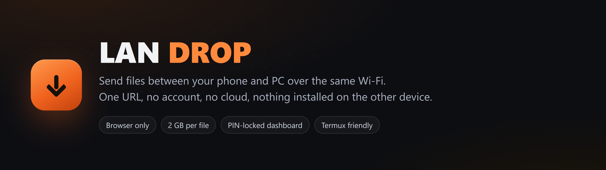
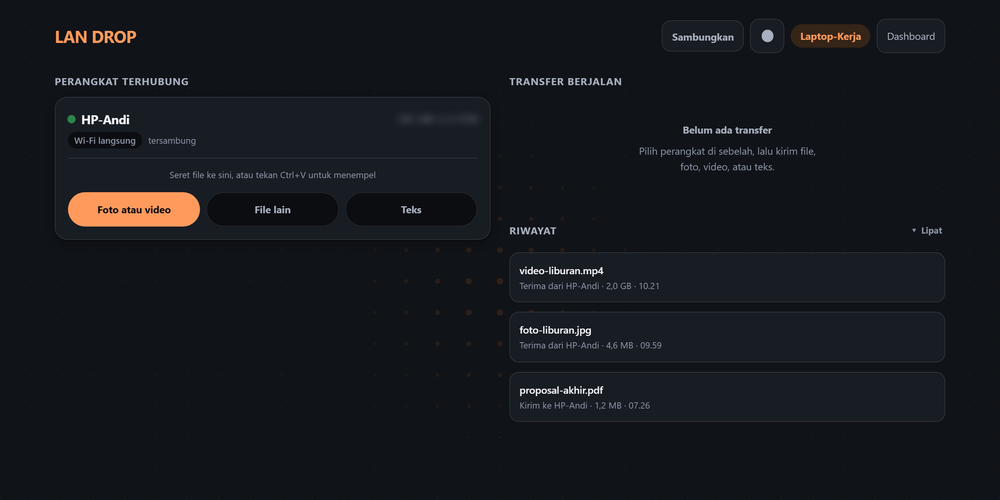
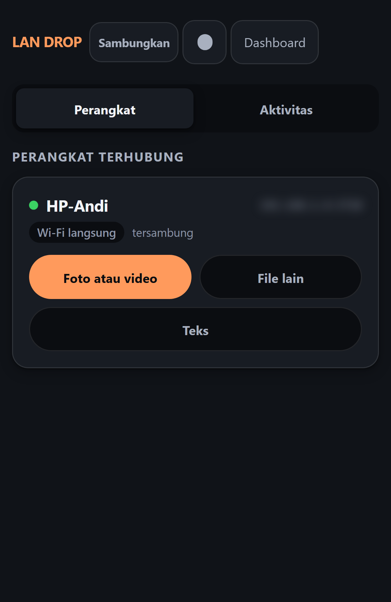
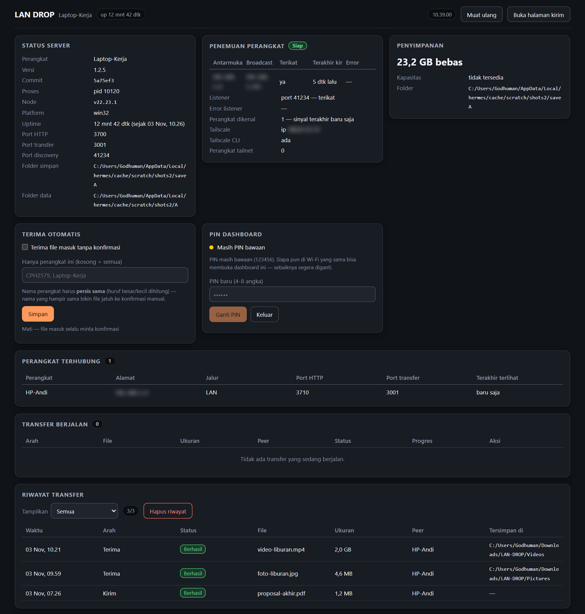

<p align="center">
  
</p>

<p align="center">
  <a href="https://www.npmjs.com/package/lan-drop-local"></a>
  <a href="https://www.npmjs.com/package/lan-drop-local"></a>
  <a href="https://github.com/Godisheree/lan-drop-local/actions/workflows/ci.yml"></a>
  
  
</p>

Share files between devices on your local network through the browser — no cloud,
no setup, no account. Open the dashboard on your phone, send a file, and it lands
straight in the save folder on your PC (or the other way around).

## Screenshots



| Phone (390 px wide) | Monitoring dashboard (PIN-locked) |
|---|---|
|  |  |

## What it does

- **The receiver decides first.** A 2 GB file is not uploaded until the other
  device taps *Terima* — decline, and not a single byte has moved.
- **Resume after a dropped Wi-Fi.** Files continue where they stopped instead of
  starting over.
- **Files, photos, video and text.** Text goes through the same flow, and `Ctrl+V`
  pastes straight onto a device card.
- **Nothing leaves your LAN.** No telemetry, no CDN, no account, no cloud.
- **IP addresses are blurred by default** — the device cards and the dashboard hide
  them until you click (or tap) them, so a screenshot or a shared screen does not
  hand out your network map.
- **Runs anywhere Node runs** — Windows, Linux, macOS, Android/Termux. Saves to
  `Downloads\LAN-DROP` (or `~/storage/pictures` on Termux).
- **Installable as a PWA** on the phone; the whole UI is one page, no app store.
- **Monitoring page behind a PIN** — peers, transfers, disk, history and live logs
  (ADR-0009).

## Install

Requires Node.js 18+.

**Run it from the repo** — gives you the arrow-key menu and the tray icon:

```bash
npm install
npm start
```

**As the `lan-drop` command** — callable from any folder, no `cd` into the repo:

```bash
npm i -g lan-drop-local
lan-drop
```

Install straight from GitHub instead — no git, no login, works on both PC and
Termux:

```bash
npm i -g https://github.com/Godisheree/lan-drop-local/archive/refs/heads/main.tar.gz
lan-drop
```

## Usage

1. Run `lan-drop` (or `npm start`).
2. The terminal prints the dashboard address, e.g. `http://localhost:3000/dashboard`.
   Open it in the PC browser, or use the LAN address (`http://192.168.x.x:3000/dashboard`)
   from a phone on the same Wi-Fi.
3. **The monitor page (`/dashboard`) asks for a PIN.** The default PIN is `123456`,
   and the login page shows that hint until you change it. Change it from the
   dashboard (PIN card) so nobody else on the same Wi-Fi can open your transfer
   history and logs. Once you sign in, that browser is remembered for 24 hours.
   It is not only the page that stays locked: the log content (`/logs`) needs that
   session too, because every line names the file, the IP address and the save
   folder.
4. Send and receive files from the main UI (`http://192.168.x.x:3000/`) — that
   page is **not** locked, so your phone never has to type anything to send.

Stop it with `Ctrl+C` in the terminal. Change the port with `PORT=4000 lan-drop`.
If that port is already taken by another app, LAN DROP moves up to the next free
port on its own and prints the new address — no manual hunting.

## Environment settings

| Env | Purpose | Default |
|---|---|---|
| `PORT` | Server port (if taken, LAN DROP moves up to a free one) | `3000` |
| `LANDROP_SAVE_DIR` | Where received files land (flat, no categories) | `%USERPROFILE%\Downloads\LAN-DROP` (Windows) / `~/storage/pictures` (Termux) |
| `LANDROP_DATA_DIR` | Folder for history, settings and upload buffers | `%APPDATA%\lan-drop` / `~/.lan-drop` |
| `LANDROP_UPLOAD_DIR` | Upload buffer folder (separate only if you want it) | `<data dir>/uploads` |
| `LANDROP_MAX_UPLOAD_MB` | Size limit per file | `2048` |
| `LANDROP_NO_BROWSER` | `1` = do not open the dashboard in a browser automatically | (empty) |
| `LANDROP_PEERS` | Manual peers (`Name@ip:port@transferPort`, comma-separated) | auto-discovery |
| `LANDROP_ALLOWED_HOSTS` | Extra hostnames accepted in the `Host` header (e.g. Tailscale MagicDNS name) | hostname + LAN/Tailscale IPs only |
| `LANDROP_ALLOW_ANY_HOST` | `1` = skip the `Host` check (behind a reverse proxy that rewrites `Host`) | (empty) |

## Notes

- **The tray icon only exists if Electron is installed** — that means running it
  from the repo (`npm install` then `npm start`). The global install deliberately
  leaves Electron out (240 MB), because global mode is meant to be a plain CLI
  server.
- **History and settings live outside the install folder**, so they survive
  package updates: `%APPDATA%\lan-drop` (Windows) or `~/.lan-drop` (Termux/Linux).

## Security

The send page has no login by design — that is what makes it zero-setup. What it
does have: a PIN on the monitoring page, a `Host` header check against DNS
rebinding, an origin check on POSTs, a 64 KB cap on every TCP frame, a path
allowlist for anything the server may stream, and no dependency that phones home.
Each of those has a regression test in `npm test`.

Reasoning lives in [`docs/adr/`](docs/adr) — start with
[ADR-0007](docs/adr/0007-keamanan-berlapis-tanpa-autentikasi.md) and
[ADR-0011](docs/adr/0011-batas-frame-tcp-dan-host-guard.md).

## Changelog

Latest version: **1.2.5** — this release carries the security work below (64 KB TCP
frame cap, `Host` guard against DNS rebinding), so `npm i -g lan-drop-local` finally
gets it.

### 1.2.5

- Fixed: `LANDROP_SAVE_DIR` was ignored outside Windows, so received files landed in
  `<data dir>/downloads` instead of the folder you configured. Found by the new CI
  (ubuntu-latest failed "file mendarat di folder simpan" on Node 18/20/22).

### 1.2.4

- Security: TCP frames are capped at 64 KB — a 4-byte length prefix from anyone who
  could reach the transfer port was enough to make the receiver grow a ~4 GB buffer —
  and the `Host` header is now checked to stop DNS rebinding (ADR-0011).
- Upload buffers moved out of the package folder into the data dir
  (`<data dir>/uploads`), so a global install no longer writes into `node_modules/`
  and an update cannot wipe a transfer that is being resumed. A failed upload can
  also no longer stop the server from booting.
- Files whose transfer was **rejected** are deleted right away instead of sitting in
  the upload buffer for 7 days.
- Accent moved from blue to orange, and the logo mark was redrawn (squircle +
  drop arrow); `--warning` shifted to amber so it cannot be read as "action".
- GitHub Actions runs `npm test` (322 checks) on Node 18/20/22.

### 1.2.2

The UI recovers by itself when a stale service worker shell leaves it half-broken
(reported on Android: a red "element #... not found in DOM" toast that stopped the
page before it started; cause was cached JavaScript from an older version, not a
broken feature). The cache is dropped, the service worker is released, and the page
reloads once — at most once per session, so it can never loop. No API changes.

### 1.2.1

README rewritten in English (no code changes).

### 1.2.0

- UI wording cleaned up: no emoji, one term for one thing, technical jargon
  replaced with everyday words. The rules live in `docs/guides/bahasa-ui.md`.
- 15 security audit findings closed (1 critical, 3 high, 4 medium, 7 low/info) —
  thumbnails and history no longer leak to callers without a PIN session.
- PIN sessions now last 24 hours (before: 30 days) and the cookie is no longer
  stored permanently in the browser.
- Tested on a real Wi-Fi path, not just loopback.

Full release notes for every version:
[CHANGELOG.md](https://github.com/Godisheree/lan-drop-local/blob/main/CHANGELOG.md).

## License

ISC.
